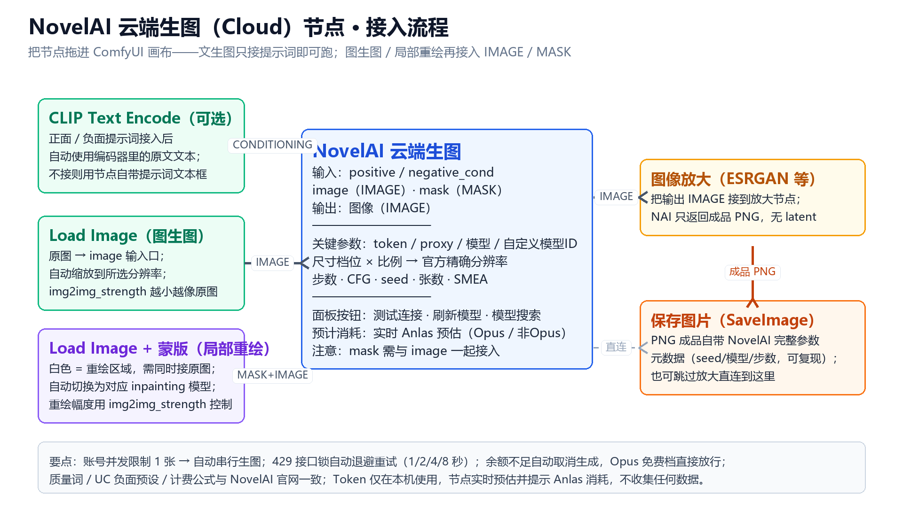

# ComfyUI-NovelAI-Cloud

调用 NovelAI 云端模型在 ComfyUI 里生成图片的节点，已上架 ComfyUI Registry。

[](https://registry.comfy.org/bigesila/novelai-cloud)
[](https://registry.comfy.org/bigesila)

输出 **IMAGE**，可直接接放大节点（ESRGAN 等）后再保存。无第三方依赖，只依赖 ComfyUI 自带的 numpy / Pillow / torch（HTTP 走 Python 标准库）。

## 功能一览

- **文生图 / 图生图 / 局部重绘**：接 IMAGE 即图生图；再接 MASK（白=重绘区）自动切换到对应 inpainting 模型变体。
- **官方模型全支持**：V5 / V4.5 / V4 / V3（含 Furry）；官方出新模型可直接在「自定义模型ID」填入即用，也可一键联网刷新模型清单。
- **官方尺寸预设**：尺寸档位（常规/大图/壁纸）× 比例（竖/方/横）→ 官方精确分辨率，避免填出不受支持的尺寸导致生成失败或白扣积分。
- **实时 Anlas 预估**：改任意参数即时显示预计消耗（区分 Opus / 非 Opus 价），余额不足时自动取消生成（不扣费），Opus 免费档直接放行。
- **面板按钮**：测试连接（只读校验 Token + 代理，显示订阅档位与余额）、刷新模型、模型搜索。
- **提示词双通道**：节点自带文本框；也可接入 CLIP Text Encode 等文本编码器（CONDITIONING），接入后自动使用编码器文本。
- **稳定体验**：账号并发 1 张 → 自动串行生成（seed = 种子 + 序号）；429 接口锁自动指数退避重试（1/2/4/8 秒）。
- **元数据可复现**：NovelAI API 返回的原始 PNG 自带完整生成参数（含 seed）。

## 安装

### 方式一：ComfyUI-Manager（推荐）

Custom Nodes Manager → 搜索 **NovelAI Cloud** → Install → 重启 ComfyUI。也可用命令 `comfy node install novelai-cloud`。

### 方式二：git clone

```bash
cd ComfyUI/custom_nodes
git clone https://github.com/Bigesila-B/ComfyUI-NovelAI-Cloud.git
# 重启 ComfyUI
```

### 方式三：手动复制

把整个 `ComfyUI-NovelAI-Cloud` 文件夹复制到 ComfyUI 的 `custom_nodes/` 目录下，重启 ComfyUI 即可。

节点在节点菜单的 **NovelAI** 分类下，名叫 **NovelAI 云端生图 (Cloud)**。

## 接入方法



- **文生图**：把「NovelAI 云端生图」接到「保存图片 (SaveImage)」即可开跑，提示词用节点自带的文本框（或接 CLIP Text Encode）。
- **图生图**：额外把 Load Image 的输出接到节点的 **image** 输入口。
- **局部重绘**：在 image 基础上再接 **mask**（白色 = 重绘区域），模型会自动切换为对应的 inpainting 变体。
- **放大**：节点的 **图像** 输出接到「图像放大 (ESRGAN / 4x-UltraSharp)」→ 保存图片；也可跳过放大直连保存。

> 懒人版：直接加载示例工作流 [workflows/basic.json](workflows/basic.json)（拖进画布即可），再填入你的 Token 开跑。

## 快速上手

1. **拿 Token**：浏览器登录 novelai.net → 右上角头像 → Account Settings → Account → **Get Persistent API Token**，复制 `pst-` 开头的一整行（无引号无换行）。
2. 在节点的 **token** 框粘贴。token 会保存在工作流里——**不要分享含此节点的工作流**。
3. **填代理**（国内必需）：在 **proxy** 框填 `http://127.0.0.1:7897`（按你代理客户端的 HTTP/混合端口改；Clash 常见 7890/7897；开 TUN/系统代理模式可留空；留空时也会读环境变量 `NAI_PROXY`）。
4. 点节点上的 **测试连接** 按钮：显示「✓ 连接成功：Opus 订阅 ｜ Anlas 余额：… ｜ 延迟 …ms」即正常。不消耗任何积分。

## 面板按钮（节点上）

| 按钮 | 作用 |
|---|---|
| **测试连接** | 验证 Token + 代理连通性，显示订阅档位和 Anlas 余额（只读，不消耗积分） |
| **刷新模型** | 联网拉取最新模型清单（走 proxy 框的代理），新模型会追加到下拉框 |
| **模型搜索** | 输入关键词即时过滤上方模型下拉框 |
| **预计消耗** | 改任何参数（步数 / 分辨率 / 张数 / SMEA / 图生图强度等）实时刷新；未测连接时同时显示「非Opus / Opus」两种价格 |

## 关键参数

- **模型**：V5 / V4.5 / V4 / V3（含 Furry）。官方出新模型时，在 **自定义模型ID** 框直接填 ID 即可立即使用，无需等插件更新；也可点 **刷新模型** 联网补全下拉框。
- **uc_preset**：官方负面预设。默认 `None`（不压制 nsfw）；选 `Heavy` 会带官方负面词（Full 系含 nsfw 前缀）。
- **quality_tags**：`Standard` 自动追加官方质量词（与官网一致），`None` 全手动。
- **尺寸 + 比例**：像官网一样两步选——`尺寸`（常规/大图/壁纸）× `比例`（竖/方/横）→ 自动得到官方支持的精确分辨率（常规竖 832×1216、常规方 1024×1024、大图横 1536×1024、壁纸竖 1088×1920…）。只列官方预设，**不会填入不支持的分辨率导致生成失败或白扣积分**；壁纸档无方图，选了会明确报错。常规/方图 ≤1024²，大图/壁纸更大、计费更高。
- **steps**：Opus 订阅在 **≤1024×1024 且 ≤28 步** 时**首张免费**；超出按公式计费。节点会实时显示并警告「单张超 140 上限」。
- **n_samples**：张数。账号同时只能跑 1 张，因此串行逐张生成（第 i 张 seed = 种子 + i）。
- **sampler / cfg_rescale / variety_plus / decrisp / smea**：与官网一致。`smea`（关/SMEA/SMEA+DYN）仅 V3 有效且会提高消耗；`variety_plus` 对应 `skip_cfg_above_sigma`；`decrisp` 对应 Decrisper（V4.5+）。噪声调度自动按模型选（V4+→Karras、V3→Native），不再暴露。
- **seed**：默认 0；右侧可切「随机/固定/递增」。

## 提示词双通道

- 节点自带 **positive_text / negative_text** 两个文本框。
- 也可把 **positive / negative_cond**（CONDITIONING）输入口接到 ComfyUI 的文本编码器（如 CLIP Text Encode）：接上后**自动改用编码器那边的文本**，忽略内置文本框。
- 技术说明：ComfyUI 的 CONDITIONING 里只有编码后的张量、不含原文，而 NovelAI 是云端自己编码（本地 CLIP 模型对它无用）。所以本节点在执行时通过隐藏的执行图**反查上游编码器节点填的 text 原文**发给 NovelAI；兼容官方 CLIP Text Encode 和大多数把文本放在 `text/string/prompt` 字段的第三方编码节点，反查不到会明确报错（不会瞎跑）。

## 图生图 / 局部重绘

- **图生图**：把 `image` 输入口接到 IMAGE（如 Load Image / 放大节点输出）。设 `img2img_strength`（越小越接近原图，也影响消耗）和 `img2img_noise`。原图尺寸与宽高不符会自动缩放。
- **局部重绘**：再接 `mask`（MASK，白色=重绘区域）。模型**自动切换到对应的 inpainting 变体**（如 V4.5 Full → `nai-diffusion-4-5-full-inpainting`）。
- 自定义模型 ID 在重绘时若找不到对应 inpainting 变体，会按原模型尝试并提示。

## 输出与放大

节点输出 **IMAGE**，和 VAE 解码节点一样可接放大链路：

```
NovelAI 云端生图 → 图像放大 (ESRGAN/4x-UltraSharp) → 保存图片
                 ↘ （想走 latent 放大）→ VAE Encode → Latent 放大 → KSampler → VAE Decode → 保存
```

NovelAI API 只返回成品 PNG，拿不到中间 latent，所以放大走图像放大节点。原始 PNG 自带 NovelAI 的完整参数元数据（含 seed），便于复现。

## 积分（Anlas）预估说明

公式逆向自 NovelAI 官方前端，V3/V4/V4.5/V5 通用：

```
单张 = max(ceil(2.9518e-6×面积 + 5.7533e-7×面积×步数) × SMEA系数 × 强度, 2)
SMEA ×1.2，SMEA+Dyn ×1.4；图生图/重绘按 strength 折算
Opus 订阅且 面积≤1024² 且 步数≤28 → 首张免费
```

锚点校验（2026-08 实测）：832×1216 @ 23 步 Opus = 0；1024×1536 @ 23 步 = 26 Anlas，公式吻合。这是尽力而为的估算，**实际扣费以官方后端为准**，界面已注明。节点会在预计消耗 > 0 且余额不足时**自动取消生成**（不消耗积分），免费档直接放行。

## 排错

| 现象 | 处理 |
|---|---|
| 测试连接报网络错误 / 超时 | 代理端口对不对、代理客户端开着；换 7890/7897/7899；或开 TUN 模式后留空 proxy |
| 401 令牌失效 | 重新获取 Persistent API Token（旧的重新生成会失效）整行粘贴 |
| 402 Anlas 不足 | 改 V4.5 Full + 832×1216 + ≤28 步（Opus 免费），或充值 |
| 403 内容政策 | 换提示词，不绕过 |
| 429 并发锁 | 自动指数退避重试（1/2/4/8 秒），无需干预 |
| 联网刷新模型失败 | 检查代理；或直接在「自定义模型ID」填新模型 ID |

## 数据与版权

- 端点与载荷：`image.novelai.net` 实测抓包对齐（2026-08-30，V4.5 Full 已验证可生成）。
- 积分公式：逆向自官方前端（参考 novelai-sdk 文档与 Aedial/novelai-api 成本表）。
- UC / 质量词预设：来自 Aedial/novelai-api 的 `ImagePreset._UC_Presets`（官方前端逆向）。
- 本插件不收集、不上传任何数据；Token 仅在本机用于请求 NovelAI 官方接口。
- 许可证：MIT（见 [LICENSE](LICENSE)）。
